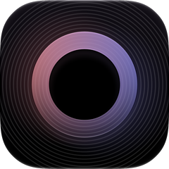
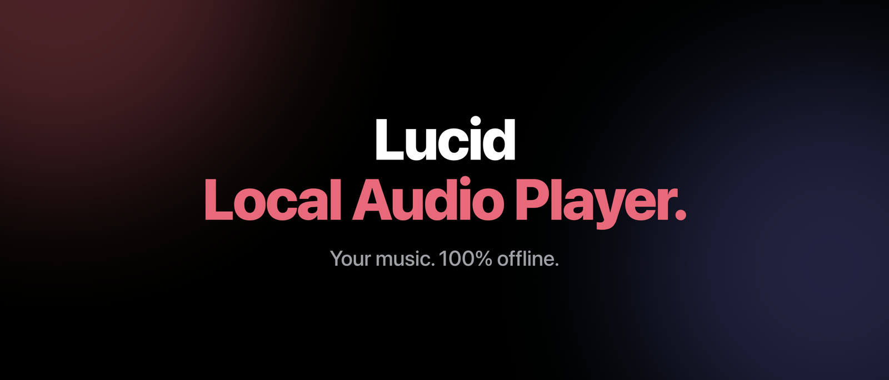
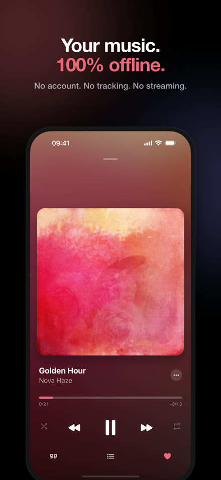
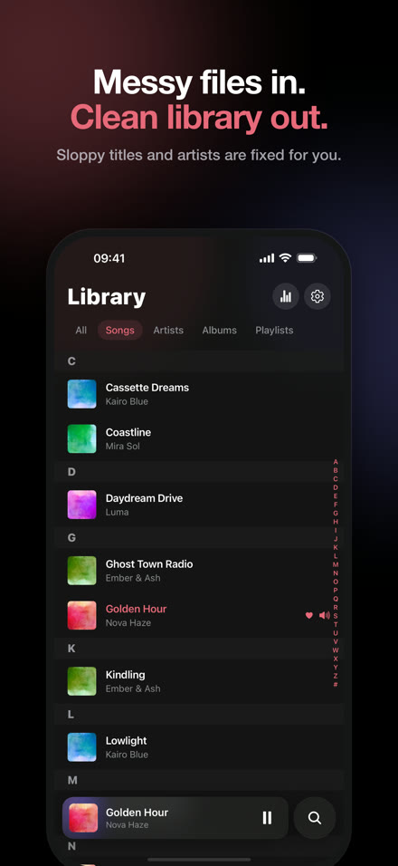
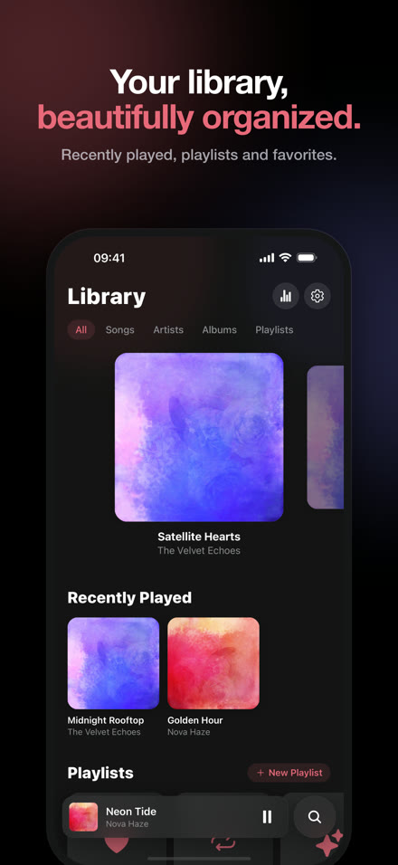
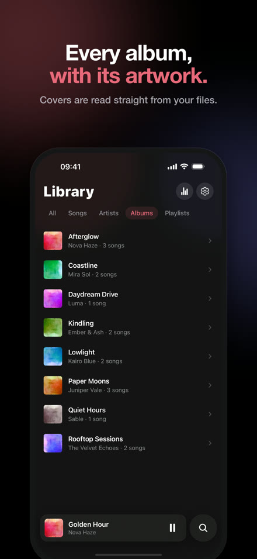
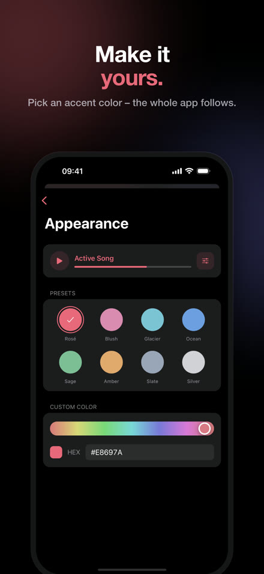

# Lucid

### Local Audio Player.

**Your music. 100% offline.**

No account. No tracking. No streaming.

  

---

## ✨ Glance at Lucid

  
  
  
  
  

<!-- iPhone Duo screenshots (outer 1398×2034, inner 2853×2007) follow once the Duo layout ships. -->

---

## 🎧 Features

- 🔒 **Private by design** – no account, no analytics, no ads, no network calls in the App Store build. Everything stays on your device.
- 📂 **Your files, offline** – import MP3, M4A, FLAC, WAV and AIFF from the Files app or iCloud Drive; folders stay in sync.
- 🎨 **Artwork that just shows up** – embedded covers in every common format, even huge ones.
- 🎤 **Lyrics like Apple Music** – synced lyrics centred in the upper third, tap a line to jump; import `.lrc` / `.txt` or time them yourself, line by line.
- 🔀 **One player, three modes** – Player, Lyrics and Up Next on one screen, with a single artwork gliding between them on a spring.
- 📋 **Up Next** – tap to play, drag to reorder, swipe to remove – with Undo.
- 🎚️ **Fine scrubbing** – drag down while scrubbing for half, quarter or fine speed, with a haptic tick per step.
- ✍️ **Song Info** – edit title, artist, album and artwork; written into Lucid's own copy of the file, your original stays untouched.
- 🌙 **Seamless playback** – gapless or crossfaded transitions, instant lock-screen skips, sleep timer, AirPods that pause when you take them out.
- 💜 **Smart playlists** – Favorites, On Repeat, Recently Added, plus Heavy Rotation and your listening stats.
- 🫧 **Native to iOS** – Liquid Glass on iOS 26+, native context menus, haptics, an accent color the whole app follows.
- ♿ **Accessible** – Dynamic Type up to the largest sizes, VoiceOver labels, Increase Contrast and Reduce Motion throughout.
- 📱 **iPhone Duo** – *in progress:* two-column player and library on the inner display.

---

## 🛠️ Tech Stack

| Layer | Choice |
| --- | --- |
| App | React Native 0.86 · Expo SDK 57 · TypeScript · React Compiler |
| Navigation | Expo Router |
| State | Zustand |
| Storage | `expo-sqlite` – library, playlists, lyrics and stats |
| Audio | `expo-audio` (two player slots for crossfade, patched for instant lock-screen updates) |
| Motion | Reanimated 4 · Gesture Handler |
| Native | Swift modules for lock-screen remote commands, UIKit context menus and atomic tag writing (AVFoundation passthrough) |

**Why it stays fast with thousands of local files:**

- **SQLite as the single source of truth** – normalized search columns and indexes, so search and A–Z jumps never scan files.
- **Fixed-height rows** – lists use `getItemLayout`, so jumping to any letter is instant and scrolling never measures.
- **Lazy native menus** – a row holds one lightweight native view; its menu is built only when it opens.
- **UI-thread animation** – every transition is a Reanimated worklet driving transforms only, no layout per frame.
- **Pre-decoded artwork** – the next and previous covers are decoded ahead of time for the lock screen.

---

## ☕ Support

Lucid is an indie app: free, no ads, no subscriptions, no data collection.
If it makes your music feel a little better, you can buy me a coffee:

<!-- TODO: add the tip-jar link -->

 

  

Made with care for people who still own their music.

